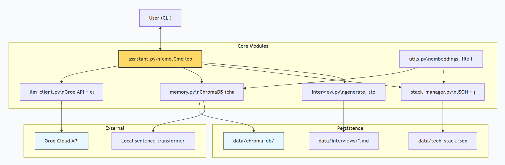

# 🧠 AI Learning Assistant – Master Your Tech Stack

> A personal, conversational AI assistant that helps you learn and master complex technology stacks (GenAI, Data Engineering, MLOps, etc.) through discussion, progress tracking, and interview preparation. Built with **Groq LLM**, **ChromaDB** memory, and a modular Python architecture.

[](https://www.python.org/)
[](https://groq.com)
[](https://www.trychroma.com)
[](LICENSE)

---

## 🚀 Features

- 💬 **Topic‑based conversational learning** – discuss any topic, ask follow‑ups, and the assistant remembers past conversations via semantic search.
- 📊 **Progress tracking** – mark topics as `not_started` → `discussing` → `interview_ready` → `completed`.
- 🎯 **Interview Q&A generation** – on‑demand creation of realistic interview questions + answers, saved as local Markdown files.
- 📝 **Interactive quiz mode** – test your knowledge using generated Q&A; get intelligent feedback (powered by Groq).
- 🔄 **Live tech stack updates** – add or modify topics through conversation or by editing a JSON file (progress is preserved).
- 🧩 **Modular design** – easy to extend with a web dashboard (Streamlit), other LLMs, or new memory backends.
- 📈 **Minimal API calls** – local embeddings (`all-MiniLM-L6-v2`) and response caching keep costs and latency low.

---

## 🧱 Architecture

The assistant is a **modular CLI application** with clear separation of concerns. All data stays on your laptop.


graph TD
    User["👤 User (CLI)"] <--> CLI["assistant.py\n(cmd.Cmd loop)"]
    
    subgraph Core Modules
        CLI --> LLM["llm_client.py\nGroq API + cache"]
        CLI --> Mem["memory.py\nChromaDB (chat history)"]
        CLI --> Stack["stack_manager.py\nJSON + progress merge"]
        CLI --> Interview["interview.py\ngenerate, store, quiz"]
        Utils["utils.py\nembeddings, file I/O"] --> Mem
        Utils --> Stack
    end
    
    subgraph Persistence
        Stack --> JSON["data/tech_stack.json"]
        Interview --> Files["data/interviews/*.md"]
        Mem --> Chroma["data/chroma_db/"]
    end
    
    subgraph External
        LLM --> Groq["Groq Cloud API"]
        Mem --> LocalEmb["Local sentence-transformers"]
    end
    
    style CLI fill:#ffd966,stroke:#333,stroke-width:2px
    style Groq fill:#e6f7ff,stroke:#333
    style Chroma fill:#e6f7ff,stroke:#333

## 🖥️ Web Dashboard (Optional)

A Streamlit dashboard provides a graphical overview of your progress and allows you to update statuses, add topics, and generate interview Q&A.

### Run the dashboard
```bash
streamlit run dashboard.py

📦 Tech Stack
Component	Technology	Purpose
LLM	Groq (Llama 3 70B / 8B via API)	Natural conversation, quiz evaluation
Vector Memory	ChromaDB (persistent)	Long‑term semantic recall of discussions
Embeddings	sentence-transformers/all-MiniLM-L6-v2	Local, free, no API call
Stack Management	JSON + custom merge logic	Human‑editable progress & topics
Interview Storage	Markdown files	Easy to read, version, or share
CLI Framework	Python cmd	Simple, extensible command loop
🛠️ Getting Started
Prerequisites
Python 3.9+

A Groq API key – get one for free (free tier: 30 requests/minute – plenty for learning)

Internet connection (only for Groq API calls – embeddings work offline)

🧪 Example Session
text
(you) discuss RAG pipelines

Assistant: RAG (Retrieval-Augmented Generation) combines a retriever (vector DB) with a generator (LLM). 
It reduces hallucinations and keeps answers current. Would you like to explore retrieval strategies or generation?

(you) How do I choose a vector database?

Assistant: For learning, FAISS or ChromaDB are simple. For production with scaling, Pinecone or Qdrant offer 
hybrid search and metadata filtering. Consider latency, indexing speed, and cost. What’s your use case?

(you) mark RAG pipelines as discussing

(you) generate interview for RAG pipelines

Assistant: Interview questions generated and saved to data/interviews/RAG_pipelines.md

(you) quiz RAG pipelines

--- Quiz on RAG pipelines ---
Q1: What is the main advantage of RAG over fine‑tuning?
Your answer: It avoids retraining and can use new documents.
✓ Correct!

Q2: Name two vector indexing algorithms.
Your answer: HNSW and IVF.
✓ Correct!
...

(you) status

--- Learning Progress ---
Data Engineering & Streaming: not_started
...
RAG pipelines: discussing

(you) add_topic MLOps for LLMs : LLMOps, Prompt Flow, CI/CD for prompts

(you) export_mermaid

Exported to exported_stack.mmd
Now copy exported_stack.mmd into Mermaid Live to generate an updated diagram.
.
